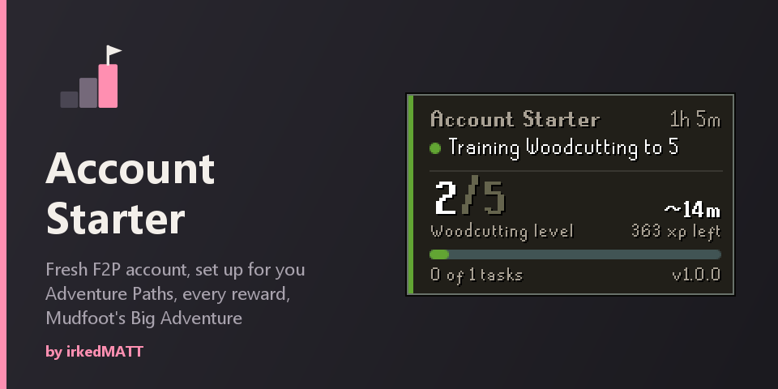

# Account Starter

Sets up a fresh free-to-play account: completes the OSRS **Adventure Paths** (Combat and Gatherer), claims every reward and does **Mudfoot's Big Adventure**. On a main account, **Quest only** does just the quest.

Author: **irkedMATT**

## What you need
- An account that told the Gielinor Guide it is new or returning (Adventure Paths on), not an ironman.
- Recommended: start in Lumbridge, where Adventurer Jon stands.
- Quest only has neither limit: it works on any account that has not done the quest, on members worlds too.

## What it does
- Collects and opens the Combat path starter kit from Adventurer Jon.
- Trains Attack, Strength, Defence, Ranged, Magic, Fishing, Woodcutting and Mining to the task levels (5, 10 and 20 for combat; 5 for the gathering skills) at free-to-play spots around Lumbridge.
- Gets free tools from the Lumbridge tutors (Finlay, Wilfred and Monlum), sorts its kit at the bank, and buries bones as it loots them.
- Does Mudfoot's Big Adventure once melee is done, before Ranged and Magic. It gives a bow, arrows, a staff, runes, 500 coins and four combat lamps.
- Claims finished task rewards from Jon, rubs the Lamp of the Gatherer on your lowest chosen gathering skill, claims the Combat path voucher rewards from the Varrock NPCs, then banks them. Can log out when finished.
- Sets the task it is working on as the in-game focus, like a player would.
- Remembers where each account was, so it carries on when you turn it back on.

## Paths
- **Everything**: every Combat and Gatherer task.
- **Skiller (gathering only)**: Fishing, Woodcutting and Mining only; Hitpoints and the combat skills stay untouched.
- **Combat only**: the combat tasks only.
- **Choose skills**: set a target for each skill in the Choose skills section, or Off to leave it alone.

## Task order
- **Smart order**: picks the cheapest next step, for example a task whose reward another task needs.
- **Whole set**: finishes one skill before moving on.
- **Path by path**: gathering first, then combat.
- **Mix it up**: switches skills in timed blocks.

## Quest only (main account)
Skips Adventure Paths and works on members worlds: it checks the bank, takes a staff and runes for the best strike spell the account can cast, does Mudfoot's Big Adventure with magic, and stops. Quest lamps are used only when you pick a skill in **Quest lamps**.

## Food
When a fight needs food and none is cooked, it takes raw fish from the bank, or fishes by level and owned tools, then cooks on the Lumbridge kitchen range after Cook's Assistant, or on a fire it lights. With **Cook food** off it uses only cooked food, and Cooking and Firemaking stay untouched.

## Arrows and runes
After Mudfoot's Big Adventure, Captain Harlan gives a shortbow and 40 bronze arrows, or a staff with air and mind runes, every 30 minutes. Between claims, **Buy at Varrock shops** walks to Lowe's Archery Emporium for arrows or Aubury's Rune Shop for runes and buys them with your coins.

**Pick up arrows** collects your own arrows near each Ranged kill.

## Panel
Shows the current task, progress, what it is doing, the next step and why, parked tasks and why, rewards waiting at Jon, the session time and the plugin version. Right-click it to switch between full and compact.

## Safety rules
- Never enters the Wilderness: unsafe routes are refused and it walks out if it ever ends up there.
- Never uses the Grand Exchange, never trades with other players and declines trade requests.
- Skills you leave out never receive XP; if one ever does, it stops and says which.
- With Hitpoints left out, auto-retaliate is turned off so a hit back can never give it XP.
- It starts every fight itself, in a safe style.
- When something fails a few times it parks that task with the reason and moves on, or stops and says why.
- Never changes your client's own antiban settings.
- Never banks the Lamp of the Gatherer or uses it on a skill you did not choose.
- Never picks a dialogue option it does not recognise.

## Known limits
- Warrior, Wizard and Ranger path accounts are not supported yet; those tasks are parked.
- Free-to-play worlds only: it stops on a members world unless Quest only is on, so members rewards are left at Jon.
