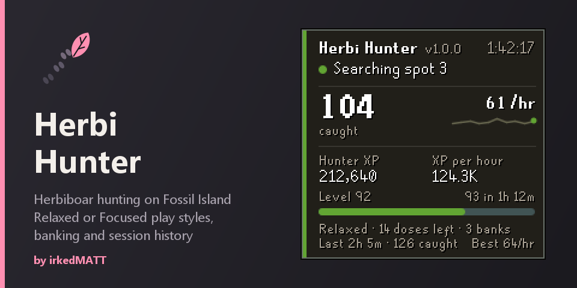

# Herbi Hunter

Hunts herbiboars on Fossil Island: follows the trail, attacks the tunnel, harvests the herbs and banks at the Museum Camp.

## Credits
- **Created by** Igor, with work from chsami and Kavraka91.
- **Reworked by** irkedMATT: play styles, humanised input and the current panel.

## What you need
- 80 Hunter (boosts work)
- 31 Herblore
- Bone Voyage (access to Fossil Island)

## Recommended
- Stamina potions in the bank
- Herb sack and magic secateurs
- 70 Agility for the hole shortcut

Start in the Mushroom Forest on Fossil Island. If you start somewhere else, it sets up at the nearest bank and travels there, using a Digsite pendant when you have one and it saves the walk.

## What it does
- Follows the trail from a start rock to the tunnel, attacks the tunnel and harvests the herbs.
- Banks at the Museum Camp when the inventory is full or a supply runs out.
- Keeps run energy up with your chosen item, and can keep the stamina effect going.
- Uses a herb sack and magic secateurs if you turn them on.
- Drops the fossils and herbs you pick.
- When it stands still for a minute it picks the trail back up from the game's state. After three minutes in a row it logs out and stops.
- Keeps session history on the panel, including your best session.

## Play styles
- **Relaxed**: a natural pace that varies from session to session, with short pauses and glances.
- **Focused**: fast and sharp, for when you are watching.

## Restock
With **Buy potions when out** on, it takes coins to the Grand Exchange when the bank has none of your run energy potion left, buys the amount you set (up to 2,000, the Grand Exchange buy limit) at 10% over its price, banks them there and comes back to hunt. Teleports are allowed on this trip only. If there aren't enough coins, there's no price, or the offer is still unfilled after 3 minutes, it logs out with the reason. This covers potions only, not strange fruit. With it off, running out logs out.

## Overlay
- **Info panel**: Full, Compact or Off. Right-click it to switch.
- Highlights for the start rocks, the next trail spot, the tunnel and the walk route, each with its own colour.
